# 🎮 Rock-Paper-Scissors AI Battle Arena

[](https://www.python.org/)
[](https://developers.google.com/mediapipe)
[](https://opencv.org/)
[](https://python-pillow.org/)

An interactive, real-time Computer Vision game that lets you play **Rock-Paper-Scissors** against an adaptive AI bot through your webcam. Powered by **MediaPipe Hands** landmark detection and an intelligent **Markov Chain** pattern prediction algorithm.

---

## 📸 Gameplay & Interface Previews

The pictures use the plain "skeleton only" camera view and made-up leaderboard names. Run `python tools/make_screenshots.py` to redraw them.

### 1. Getting in
| Start screen with the leaderboard | Your name | Is this you? |
| :---: | :---: | :---: |
| 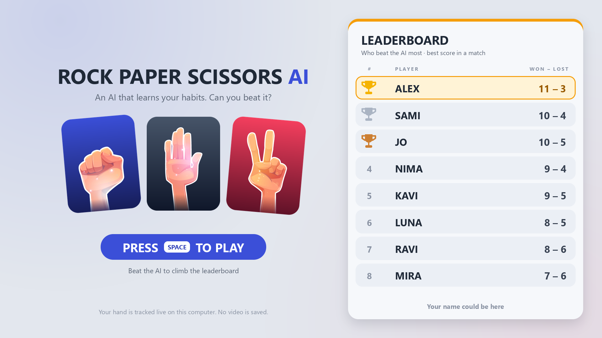 | 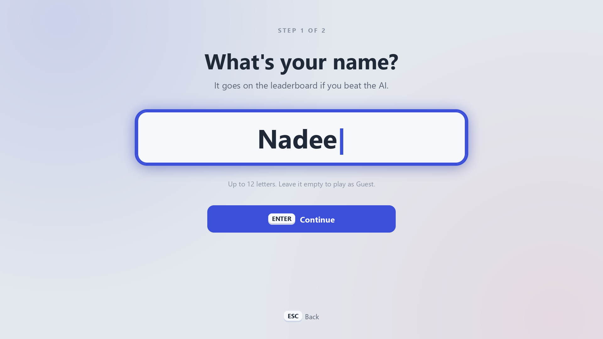 | 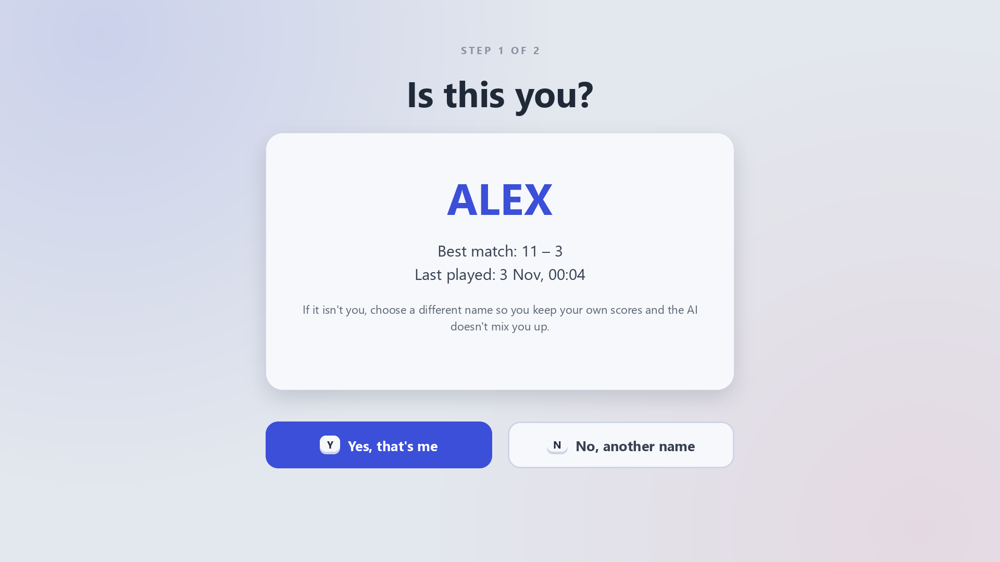 |
| *Who beat the AI most, then press SPACE* | *The only typing* | *Asked when a name is already taken* |

### 2. The match
| Camera check | Ready | Countdown |
| :---: | :---: | :---: |
| 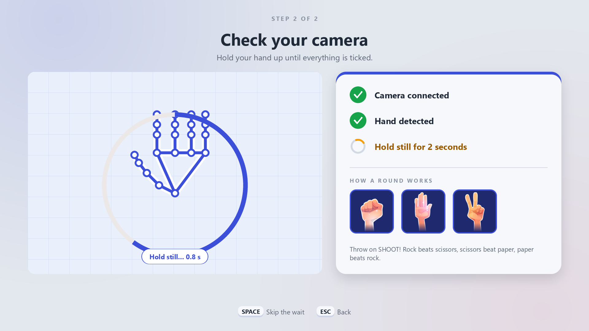 | 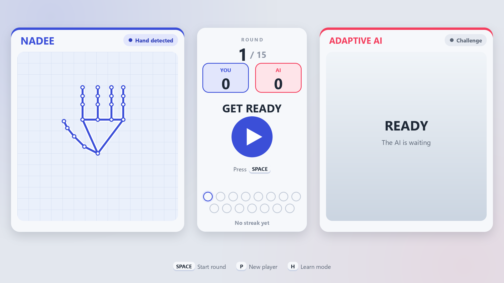 | 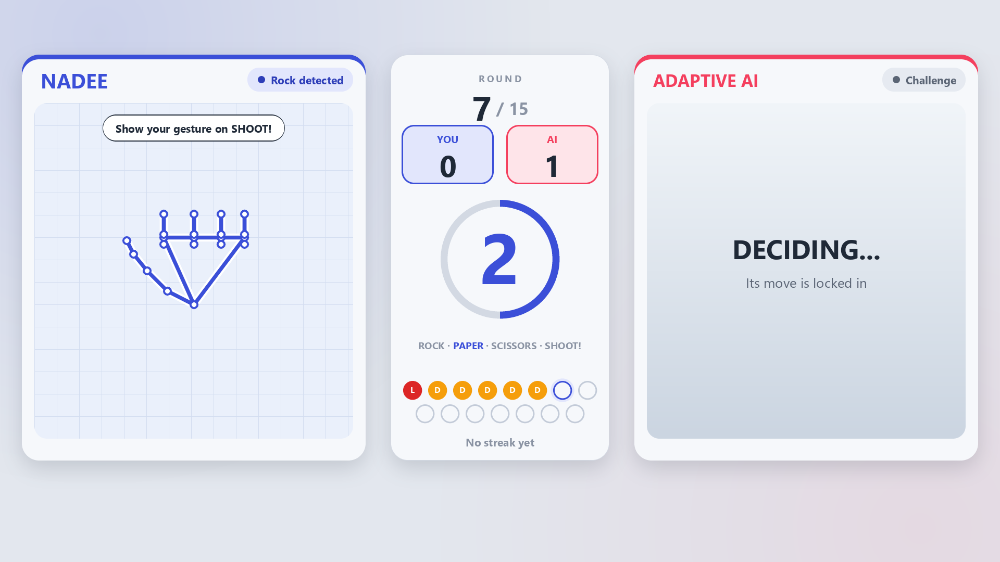 |
| *Hold a hand up until everything is ticked* | *Press SPACE for each round* | *The AI has already locked its move* |

### 3. Results
| You win | AI wins | Draw |
| :---: | :---: | :---: |
| 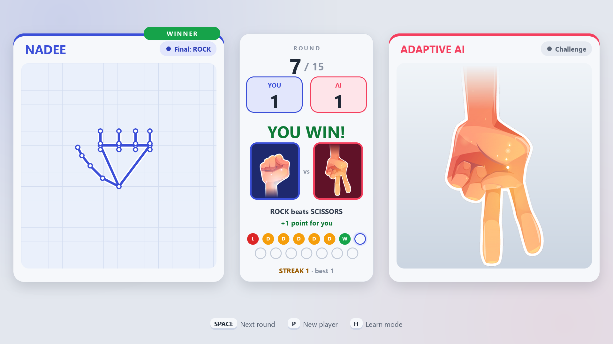 | 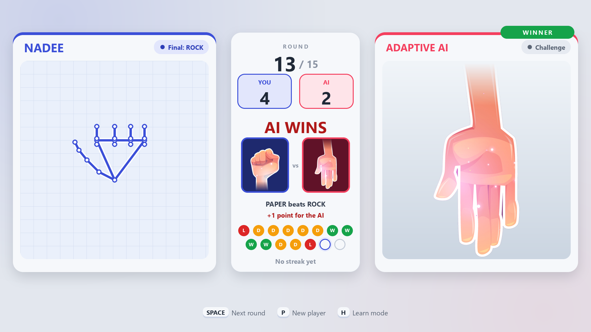 | 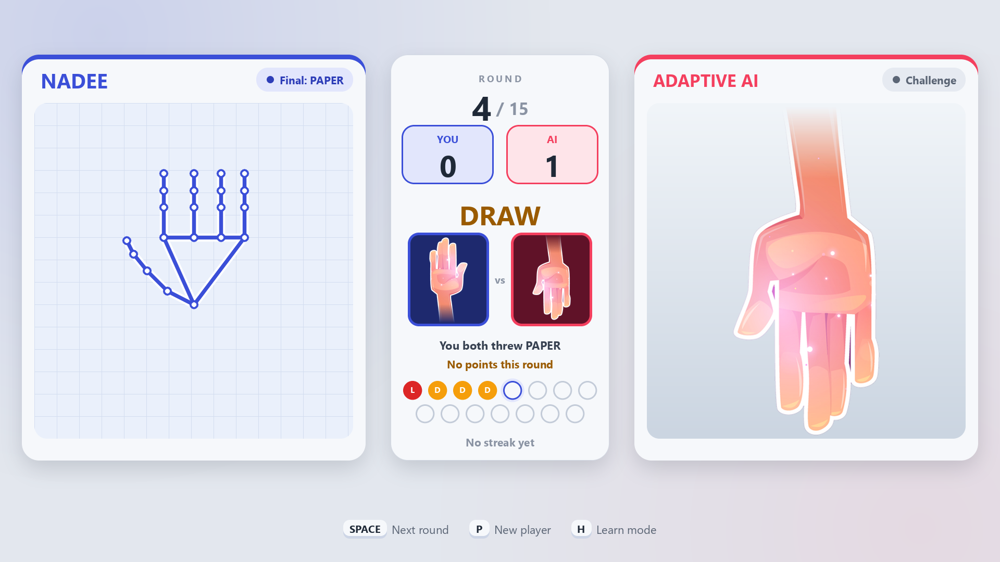 |

| Learn mode | Missed round | Report card |
| :---: | :---: | :---: |
| 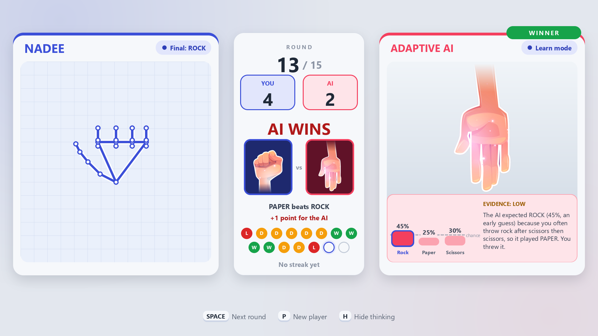 | 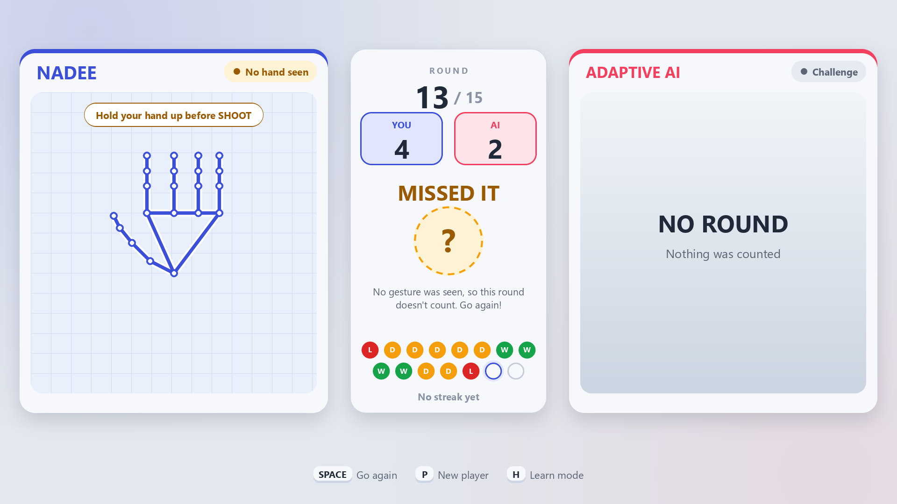 | 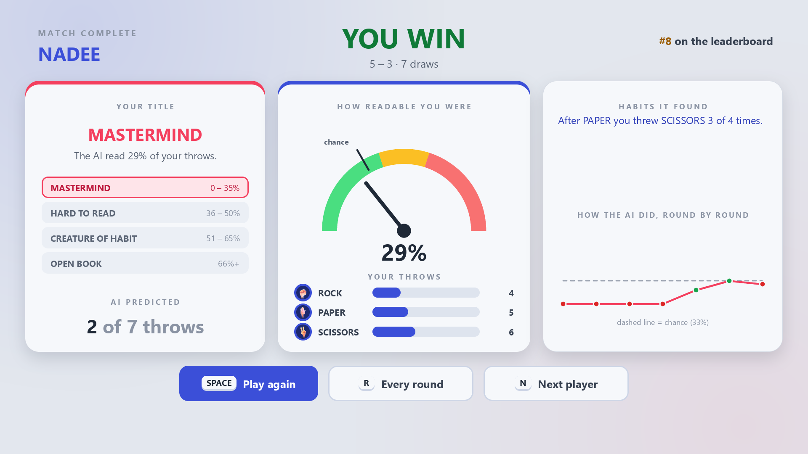 |
| *What the AI expected, and why (press H)* | *No hand seen: the round does not count* | *A title, how readable you were, and the habits found* |

---

## ✨ Features

- 🖐️ **Real-Time Hand Tracking**: Uses Google MediaPipe's 21 3D-landmark skeletal tracking pipeline to recognize Rock, Paper, and Scissors gestures instantly at 30+ FPS.
- 👤 **Multi-Player Profiles & Persistent Memory (`players_data.json`)**:
  - Enter your player name at startup or switch profiles on the fly with `[P]`.
  - Saves individualized Markov Chain behavioral transition matrices, high scores, win streaks, and match stats per player across game sessions!
- 🧠 **Adaptive AI (Markov Chain Predictor)**:
  - Tracks player transition patterns between moves in real-time.
  - Anticipates the user's next gesture based on past behavioral probability and counters it dynamically.
  - Toggle between **Predictive AI** and **Random AI** on the fly.
- 🎨 **3-Column Arena & Cyberpunk HUD**:
  - Crisp TrueType typography rendered via PIL RGBA alpha blending.
  - Dedicated center camera viewport with 100% natural aspect ratio and live skeletal tracking.
  - Unobstructed side-by-side **Player** and **AI** action cards.
  - Animated 360° circular radial countdown timer.
  - Live scoreboard with Win Streaks and recent match outcome pills (`W` / `L` / `D`).
- 🖥️ **Full-Screen Responsive**: Seamlessly adapts to full screen and standard window modes with the press of `[F]`.

---

## 🏗️ System Architecture

```
[ Webcam Input ] 
       │
       ▼
[ OpenCV Frame Capture ] ──► [ RGB Conversion ]
                                   │
                                   ▼
                       [ MediaPipe Hands Pipeline ]
                                   │
                   ┌───────────────┴───────────────┐
                   ▼                               ▼
       [ 21 3D Landmarks ]              [ Cyber Skeleton Overlay ]
                   │
                   ▼
     [ Geometric Gesture Classifier ]
       (Rock / Paper / Scissors)
                   │
                   ▼
       [ Game State Machine ]
    (LOGIN ➔ READY ➔ COUNTDOWN ➔ RESULT)
                   │
                   ├───────────────┐
                   ▼               ▼
        [ Markov Chain AI ]   [ Score & Streak Tracker ]
                   │
                   ▼
   [ PIL + OpenCV HUD Renderer ] ──► [ Fullscreen Arena Display ]
```

---

## 🕹️ How a visit works

1. **Start screen:** the leaderboard shows who beat the AI most. Press `SPACE`.
2. **Your name:** type a name (up to 12 letters) and press `ENTER`. Leave it empty to play as a guest, who is never saved. If someone already plays under that name, the game asks "Is this you?" (`Y` or `N`), so two visitors never share scores.
3. **Camera check:** hold your hand up for two seconds until everything is ticked, then press `SPACE` to start the match.
4. **The match:** 15 rounds. Show rock, paper or scissors on SHOOT! The AI has already locked its move.
5. **Report card:** a title, how readable you were, the habits it found, and your leaderboard rank.

## 🎛️ Controls

| Key | Action |
| :---: | :--- |
| **`[SPACE]`** | Play, start a round, move on |
| **`[ENTER]`** | Confirm your name |
| **`[H]`** | Learn mode: show what the AI expected after each round |
| **`[R]`** | On the report: see every round |
| **`[N]` / `[P]`** | Next player (back to the start screen) |
| **`[F]`** | Toggle Fullscreen / Windowed mode |
| **`[Ctrl+A]`** | Admin settings: match length, default mode, hide the camera picture, idle time, clear the leaderboard, sound |
| **`[Q]`** | Quit, but only while the admin panel (Ctrl+A) is open, so visitors cannot close the game |

---: | :--- |
| **`[SPACE]`** | Start round / trigger 3-second animated countdown |
| **`[P]`** | Switch active Player Profile & load individual AI memory |
| **`[F]`** | Toggle Fullscreen / Windowed mode |
| **`[D]`** | Switch AI Mode (*Predictive* vs *Random*) |
| **`[R]`** | Reset scoreboard & streaks |
| **`[Q]`** | Quit, but only while the admin panel (Ctrl+A) is open, so visitors cannot close the game |

---

## 🚀 Quickstart & Installation

### 1. Clone the repository
```bash
git clone https://github.com/manodyasasmini/Rock-Paper-Scissors-AI.git
cd Rock-Paper-Scissors-AI
```

### 2. Set up virtual environment
```bash
python -m venv venv
# On Windows:
venv\Scripts\activate
# On macOS/Linux:
source venv/bin/activate
```

### 3. Install dependencies
```bash
pip install -r requirements.txt
```

### 4. Launch the game
```bash
python rps_game.py
```

---

## 🛠️ Tech Stack & Concepts

- **Language**: Python 3.10+
- **Computer Vision**: OpenCV, Google MediaPipe
- **Machine Learning / AI**: Discrete-time Markov Chains, Transition Probability Matrices
- **Graphics & UI**: PIL (Pillow), Alpha Compositing, Bézier & Radial Arc geometry

---

## 👤 Author

**SMS Abeyrathne** · 235501H · BSc (Hons) Artificial Intelligence
