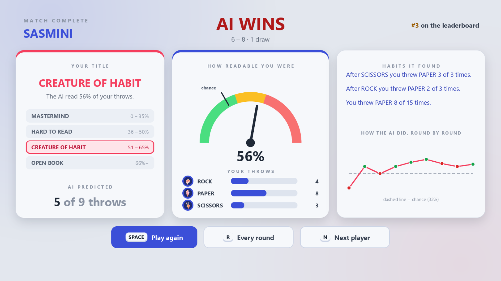
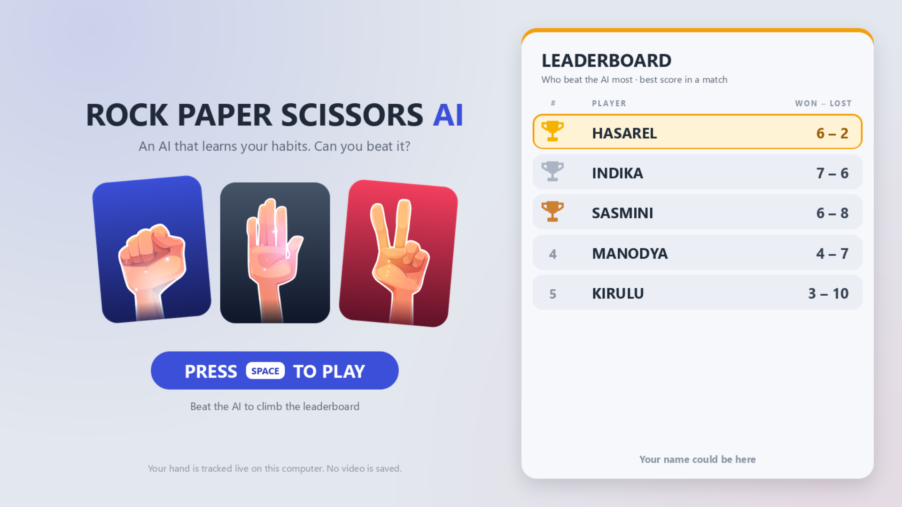
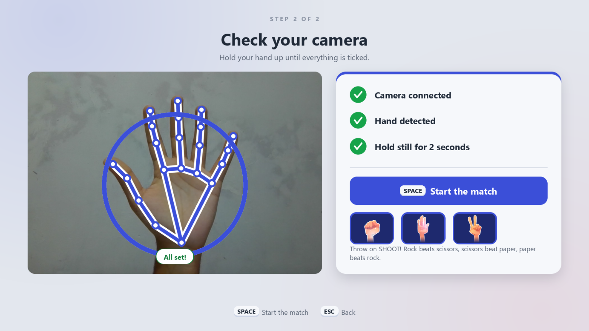
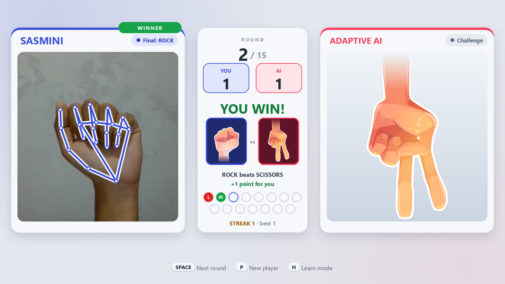
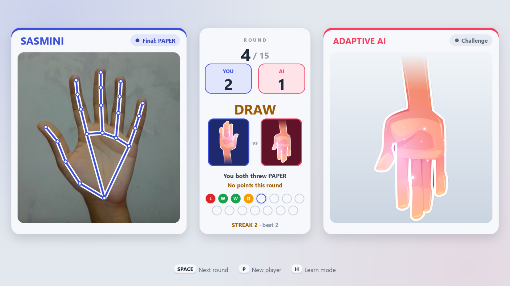
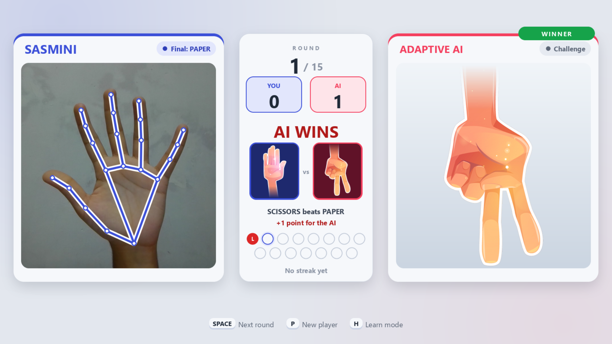
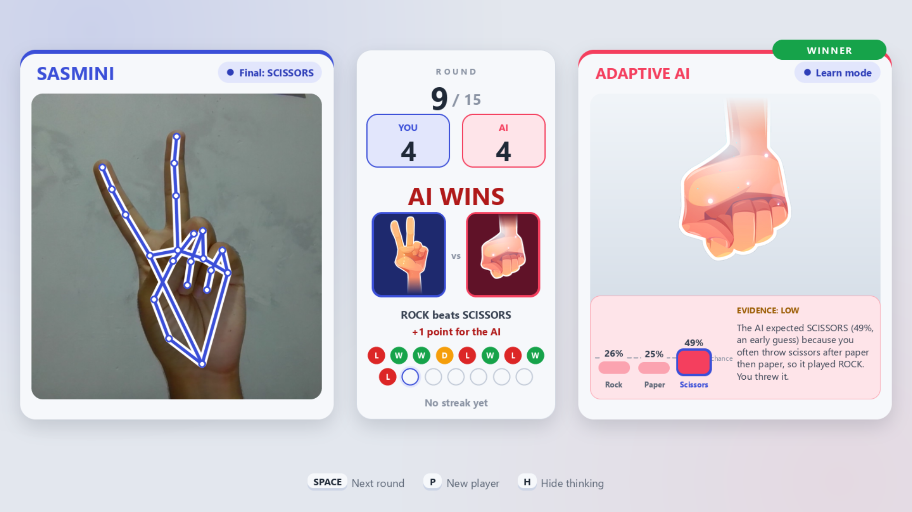
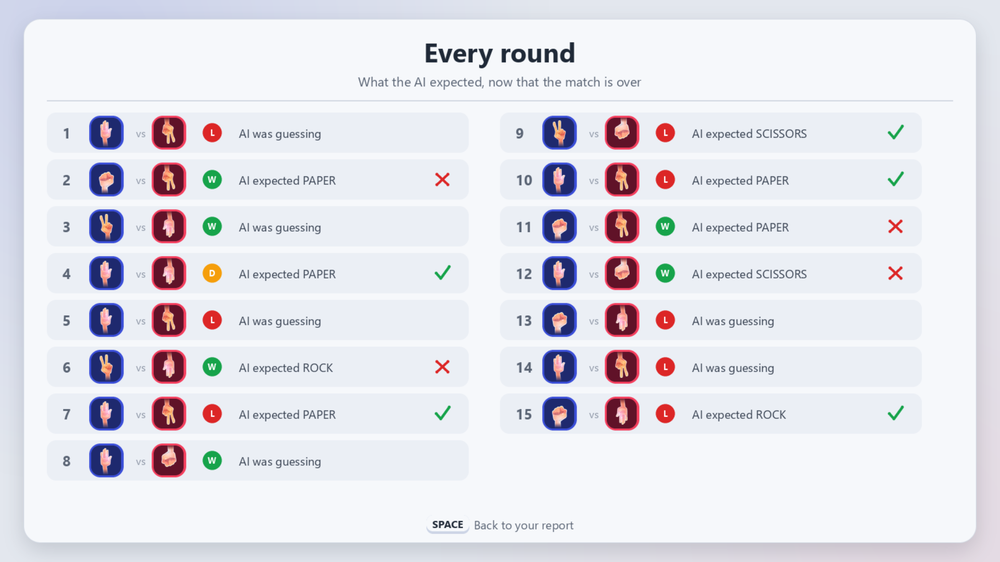
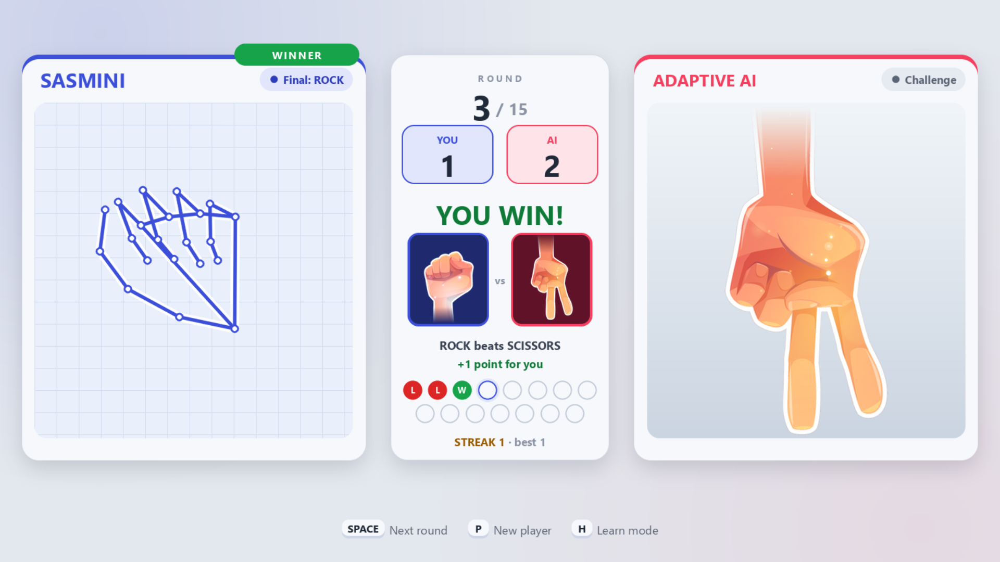
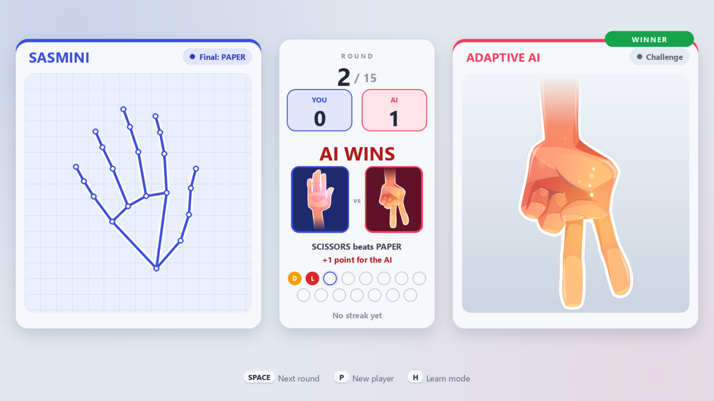

# Rock Paper Scissors AI

[](https://www.python.org/)
[](https://developers.google.com/mediapipe)
[](https://opencv.org/)
[](https://python-pillow.org/)

Play **Rock Paper Scissors** against an AI with your bare hand and a webcam. The AI learns your habits as the match goes on, and at the end the game shows you what it found out about you.



## Why this project

Simple Rock Paper Scissors bots either play at random or follow one fixed rule, so they are pure luck or easy to beat. When a bot does learn from the player, the player rarely sees what it learned. This game makes the learning visible, and honest: every guess is shown next to the one-in-three chance level.

## How a visit works

1. **Start screen:** the leaderboard shows who beat the AI most. Press `SPACE`.
2. **Your name:** type up to 12 letters and press `ENTER`. Leave it empty to play as a guest, who is never saved. If someone already plays under that name, the game asks "Is this you?" (`Y` or `N`), so two visitors never share scores.
3. **Camera check:** hold your hand up for two seconds until everything is ticked, then press `SPACE`.
4. **The match:** 15 rounds. Press `SPACE` for each round, then show rock, paper or scissors on SHOOT! The AI locked its move before your throw was read.
5. **Report card:** a title (Mastermind, Hard to read, Creature of habit or Open book), a gauge showing how readable you were, your throw mix, the habits it found, and your leaderboard rank. `R` shows every round and what the AI expected.

## Screens

Screenshots from the running game, played by test players.

| Start screen | Is this you? | Camera check |
| :---: | :---: | :---: |
|  |  |  |
| *Who beat the AI most, then press SPACE* | *Asked when a name is already taken* | *Hold a hand up until everything is ticked* |

| You win | Draw | AI wins |
| :---: | :---: | :---: |
|  |  |  |

| Learn mode | Report card | Every round |
| :---: | :---: | :---: |
|  |  |  |
| *What the AI expected, and why (press `H`)* | *A title, how readable you were, the habits found* | *Every throw and what the AI expected* |

**Skeleton-only view** (operator panel, key 3) replaces the camera picture with a plain grid and still draws your hand, so no face or room appears on screen:

| You win | AI wins |
| :---: | :---: |
|  |  |

## The AI

Four small predictors each guess your next move, and the one with the best recent record counts most:

- **Frequency:** how often you throw each move.
- **Last move:** what usually follows your previous throw.
- **Last two moves:** what usually follows your last pair of throws.
- **Win-stay / lose-shift:** how you react to winning, losing or drawing.

Old observations fade (a half-life of about 13 rounds), so it keeps up when you change tactics. Estimates start near 33% and only move with real evidence, so two throws can't produce a "90%" prediction.

The AI picks its move by expected score, so it leans towards the counter to what it expects but still mixes in surprises. It plays almost at random when nothing stands out, which also keeps it fair against a player who really does throw at random.

**Fair by design:** the AI locks its move when the countdown starts, before the camera reads your throw. During a match it shows no reasoning, because that would tell you which habit to break.

### Measured against scripted players

`python -m ai.simulate` plays 400 games of 30 rounds against scripted players and compares the AI with the first version of this project:

| Player | AI wins (net per round) | AI guesses right |
| :--- | :---: | :---: |
| Throws at random | +0.015 (fair) | 34% |
| Favours rock (60%) | +0.237 | 51% |
| Cycles R-P-S | +0.872 | 91% |
| Repeats R-R-P | +0.800 | 87% |
| Win-stay, lose-shift | +0.847 | 90% |
| Counters the AI's last move | +0.866 | 92% |
| Switches habit midway | +0.321 | 57% |

A fair match is 0.000, and guessing by chance is right 33% of the time. These are scripted players, so real people will differ. The settings in `config.py` are meant to be re-tuned after play-tests.

## Controls

| Key | Action |
| :---: | :--- |
| `SPACE` | Play, start a round, move on |
| `ENTER` | Confirm your name |
| `H` | Learn mode: show what the AI expected after each round |
| `R` | On the report: see every round |
| `N` / `P` | Next player (back to the start screen) |
| `F` | Toggle fullscreen |
| `Ctrl+A` | Operator panel (below) |
| `Q` | Quit, only while the operator panel is open, so visitors cannot close the game |

### Operator panel (`Ctrl+A`)

Press the number to change a setting. Changes are saved straight away in `settings.json`.

1. **Match length:** 10, 15, 20 or no limit.
2. **Default mode:** Challenge or Learn.
3. **Camera picture:** full, or "skeleton only", which hides faces completely and still draws the hand.
4. **Return to start screen:** after 10, 20 or 30 seconds without a hand or key. A "Still there?" prompt appears first.
5. **Leaderboard:** press twice to clear it.
6. **Sound:** countdown ticks and short result jingles (Windows only).

## Privacy

The webcam picture is used only to find your hand and to draw it on screen. No video or image is recorded or saved. Saved files hold only player names, leaderboard scores and the AI's statistics about each player. Guests are never saved. If the screen faces a public walkway, switch on "skeleton only" (see the pictures above).

## Install and run

Tested on Windows with Python 3.12 and a webcam.

```bash
git clone https://github.com/manodyasasmini/Rock-Paper-Scissors-AI.git
cd Rock-Paper-Scissors-AI
python -m venv venv
venv\Scripts\activate
pip install -r requirements.txt
python main.py
```

The game opens fullscreen. If the camera is unplugged or used by another app, it says so and keeps retrying.

On macOS or Linux it should run, but the interface looks for Segoe UI and Arial in `C:\Windows\Fonts`, and sound uses `winsound`, so text falls back to a basic font and the game is silent.

## Tests

```bash
pip install -r requirements-dev.txt
python -m pytest
```

The tests need no camera: they use made-up hand landmarks and check the game rules, the AI, the screens at several sizes, the leaderboard, the operator settings and the sounds.

## Project layout

| Folder or file | What it holds |
| :--- | :--- |
| `main.py` | The camera loop and window |
| `config.py` | Every tunable value in one place |
| `vision/` | Camera and MediaPipe, and the rock / paper / scissors classifier |
| `ai/` | The adaptive AI and the simulator |
| `game/` | Game rules and states, the leaderboard, saved players, settings, sounds |
| `ui/` | The screens, drawn with Pillow on a 1280 x 720 design scaled to the window |
| `assets/gestures/` | The three hand pictures |
| `tools/` | Scripts that make the icons, screenshots and poster pictures |
| `design/` | Screen mockups, colour experiments and poster material |
| `rps_game.py` | The first version of the game, kept as a backup |

## Tech stack

- **Python 3.12:** game logic, AI and tests
- **MediaPipe Hands:** 21-point hand landmark tracking
- **OpenCV:** camera capture and the window
- **NumPy:** the AI's decaying probability tables
- **Pillow:** all text, panels and artwork
- **JSON:** saved players and the leaderboard

## Credits

The hand pictures are cut from stock artwork; see `assets/gestures/NOTICE.md`.

Created by **S.M.S. Abeyrathne** · 235501H · BSc (Hons) Artificial Intelligence
